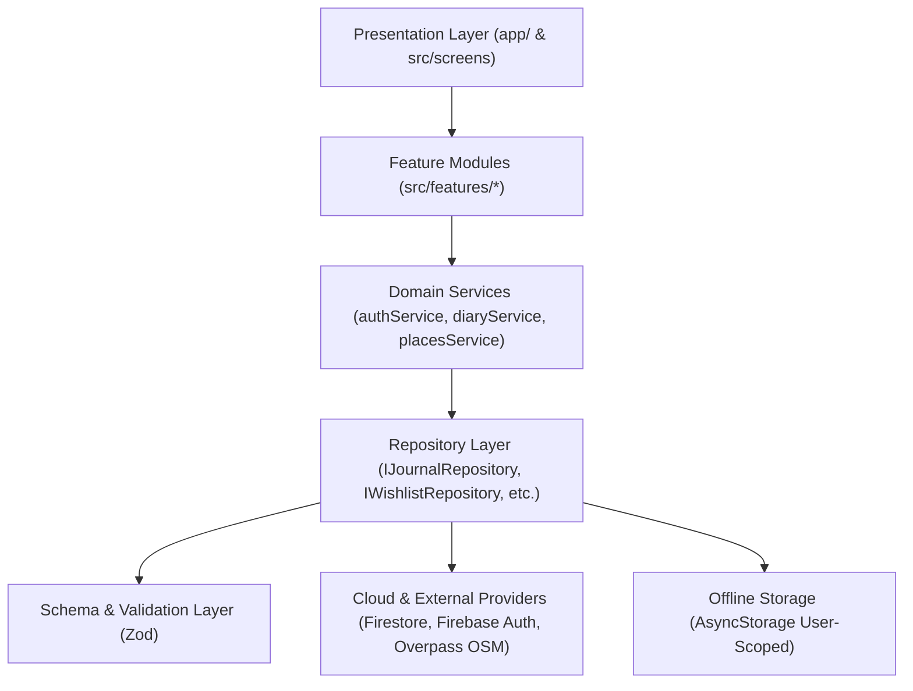

# MouthJournal — Architecture Blueprint & Engineering Specification

## 1. Executive Architecture Summary

MouthJournal is engineered as a **personal-first, offline-resilient, strictly private culinary journaling application**. It follows clean architecture, repository patterns, and domain-driven design principles to ensure maintainability, data integrity, strict user isolation, and modular future extensibility.

---

## 2. Target Technology Stack

| Layer | Technology | Version / Specification |
|---|---|---|
| **Runtime & Platform** | React Native / Expo | Expo SDK 58 (React Native 0.88, React 19.3) |
| **Language & Typing** | TypeScript | v5.8+ Strict Mode (`strict: true`) |
| **Navigation & Routing** | Expo Router | v4 / SDK 58 File-based routing |
| **State & Context** | React Context + Custom Hooks | `AuthContext`, user session state |
| **Validation & Schema** | Zod | v3.25+ Runtime domain validation schemas |
| **Backend & Cloud** | Firebase | Auth, Cloud Firestore (v13+ modular SDK), Firebase Storage |
| **Local Cache** | React Native AsyncStorage | User-scoped keying (`@mouthjournal_cache_{userId}_*`) |
| **Geocoding & Places** | OpenStreetMap Adapter | Nominatim + Overpass API with AbortController timeout |
| **UI Design System** | Custom Semantic Tokens | Warm Cafe Aesthetic (#FBF7F2, #C85A32, #4A2E1B, #9E8579) |
| **Icons & Typography** | Lucide React Native + Google Fonts | Caveat + Playfair Display |

---

## 3. Domain Boundaries & Layered Structure



### 3.1. Layer Responsibilities
1. **Presentation Layer (`app/` & `src/screens`)**:
   - Thin route wrappers in `app/` extract parameters and wire navigation.
   - Screen components in `src/screens` manage presentation, view models, and user interactions.
   - Strictly 5 bottom navigation tabs: `Diary`, `Explore`, `Add (+)`, `Wishlist`, `Profile`.
   - Settings is accessed exclusively from `Profile` and partitioned into 5 categories.

2. **Feature Modules (`src/features/*`)**:
   - High cohesion feature barrels encapsulating auth, diary, journal editor, photo gallery, explore, places, wishlist, profile, settings, and recommendations.

3. **Domain Service Layer (`src/services/*`)**:
   - Orchestrates multi-repository workflows (e.g., logging out clears caches across all repositories).
   - Enforces business rules and transforms raw data into presentation-ready structures.
   - Zero fabricated metrics: random generators have been eliminated.

4. **Repository Layer (`src/repositories/*`)**:
   - Strict interface contracts (`IJournalRepository`, `IWishlistRepository`, `IUserPreferencesRepository`, `IUserProfileRepository`).
   - Implements offline-first caching and remote cloud synchronization.
   - All operations are scoped to a mandatory `userId`.

5. **Validation Layer (`src/schemas/*`)**:
   - Zod schemas validate both inbound network payloads and outbound cloud mutations.
   - Prevents database pollution, negative prices, out-of-range ratings (1–5), or missing ownership keys.

---

## 4. Multi-Tenant User Isolation & Security Model

### 4.1. The Principle of Personal-First Privacy
MouthJournal is strictly a personal journal. Public feeds, following/follower relationships, public profiles, likes, and comments are prohibited.

### 4.2. Cloud Firestore Security Architecture
All user-owned data is stored in hierarchical subcollections rooted at `/users/{userId}/`:

```text
/users/{userId}                         (User Profile Document)
   ├── /journals/{journalId}            (Private Culinary Journals)
   ├── /wishlist/{itemId}               (Private Saved Places)
   └── /preferences/settings            (Private App Settings & Food Preferences)
```

**Security Rules Enforcement (`firebase/firestore.rules`)**:
- Global default: Deny all reads/writes (`allow read, write: if false;`).
- Hierarchical owner enforcement: `request.auth.uid == userId` is required for every document read, create, update, and delete.
- Inbound data constraints: Validates types, non-empty strings, valid enum categories (`food`, `drinks`, `wisata`), and rating boundaries (0–5).

### 4.3. Firebase Storage Security Rules (`firebase/storage.rules`)
- Path scoping: All food photography must be uploaded under `/users/{userId}/photos/{filename}`.
- Ownership verification: Uploads require `request.auth.uid == userId`.
- Resource constraints: Content type must match `image/*` and file size must not exceed 10 MB (`request.resource.size <= 10 * 1024 * 1024`).

### 4.4. Local Cache Isolation
Legacy shared AsyncStorage keys (e.g. `@mouthjournal_diaries`) have been migrated to strictly isolated keys:
- `@mouthjournal_cache_{userId}_journals`
- `@mouthjournal_cache_{userId}_wishlist`
- `@mouthjournal_cache_{userId}_settings`
- `@mouthjournal_cache_{userId}_profile`

When a user logs out (`AuthService.logout()`), all user-scoped cache keys are purged immediately, preventing cross-user data leakage on shared devices.

---

## 5. Interchangeable Places & Geocoding Architecture

### 5.1. The Provider Adapter Pattern
The places system decouples location consumption from third-party APIs using the `IPlacesProvider` interface:

```typescript
export interface IPlacesProvider {
  readonly providerId: string;
  searchNearby(options: NearbySearchOptions): Promise<Place[]>;
  getPlaceDetails(placeId: string): Promise<Place | null>;
}
```

### 5.2. How to Add an Alternative Provider
To integrate an alternative provider (e.g., Google Places, Mapbox, or Foursquare):
1. Create an adapter implementing `IPlacesProvider` in `src/services/places/` (e.g., `GooglePlacesAdapter.ts`).
2. Implement `searchNearby` and `getPlaceDetails`, mapping API responses to the normalized `Place` model (`src/models/place.ts`).
3. Inject the new adapter into `placesService.ts` or configure it conditionally via environment variables (`EXPO_PUBLIC_PLACES_PROVIDER=google|osm`).
4. **Zero changes are required in `ExploreScreen.tsx`, `PlaceCard.tsx`, or any consumer screen.**

### 5.3. OpenStreetMap Implementation Details
- **Overpass API**: Searches amenities (`cafe`, `restaurant`, `fast_food`, `bakery`, `tourism`) within a radius (1–10 km).
- **Resilience**: Configured with an 8-second `AbortController` timeout to prevent UI freezes on sluggish public Overpass instances.
- **Data Integrity**: Uses pure Haversine distance calculation (`src/utils/geo.ts`) and never manufactures fake star ratings or visitor counts.

---

## 6. Offline-First & Synchronization Strategy

1. **Read Path**:
   - Check local cache (`@mouthjournal_cache_{userId}_*`). If present, return immediately for instant render.
   - If connected and remote query succeeds, update local cache in the background and return latest data.
   - If offline or remote query fails, fall back smoothly to cached data.
2. **Write Path**:
   - Optimistically write to local cache for instant UI feedback.
   - Persist to Cloud Firestore (`/users/{userId}/...`).
   - If network is unavailable, item remains in local storage ready for sync.
3. **Cache Eviction**:
   - User-triggered cache clearing available in **Settings > Data & Support** via `clearUserCache(userId)`.
   - Automatic cache purge on user logout.

---

## 7. Future Feature Integration Points

### 7.1. Culinary Calendar & Meal Timeline
- **Hook**: Extends `IJournalRepository.getJournals(userId)`.
- **Query**: Filter by `visitedAt` date range (e.g., `startOfMonth` to `endOfMonth`).
- **Data Source**: Every journal entry already includes `visitedAt: ISO 8601 string`.

### 7.2. Analytics & Taste Profile
- **Hook**: Aggregates `criteriaRating` (taste, ambiance, service, price) and `tags`.
- **Data Source**: `JournalSchema.criteriaRating` tracks dimensional scores.
- **Outputs**: Spider/radar charts showing user flavor leanings (e.g., "Prefers high-ambiance specialty cafes with acidic light roasts").

### 7.3. Budget & Expense Tracking
- **Hook**: Aggregates `totalSpent` and `menuItems[].price`.
- **Data Source**: Every journal records `totalSpent: number` and individual menu pricing.
- **Reporting**: Monthly spend by category, average cost per cafe visit, and price-to-value satisfaction ratios.

### 7.4. AI Recommendations Evolution
- **Phase 1 (Current)**: Rule-based heuristics matching user food preferences (favorite categories, search radius).
- **Phase 2 (Future)**: Vector embedding & multi-criteria recommendation engine using user taste profiles and journal sentiment.
- **Decoupled Architecture**: `AIRecommendationsScreen` interacts via domain interfaces, remaining completely optional without affecting the primary journal workflows.
